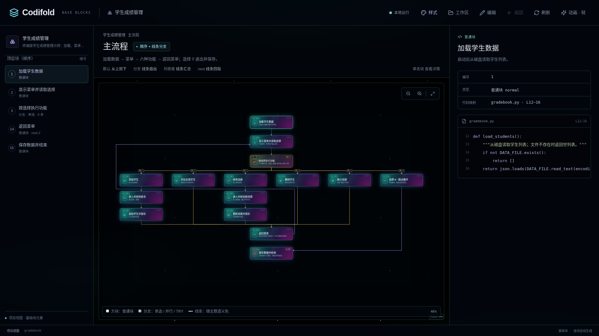

# Codifold · 中文流程阅读器

把项目浓缩成少量汉语步骤，再按需展开。先理解“程序在做什么”，需要细节时再看对应代码。



流程描述由人或外部 AI 编写成 JSON。Codifold 只负责校验、读取、渲染和编辑 JSON，不分析源码、不调用模型、不执行被讲解的项目。

要把一个真实项目转换成流程，从 [docs/conversion-guide.md](docs/conversion-guide.md) 开始；它规定了入口链路画法、代码全覆盖判定和验收门禁。大项目不要手写整份最终 JSON，用 [docs/workbench.md](docs/workbench.md) 里的转换工作台：AI 只写局部草稿，工具分配 id、解析引用、写文件并整项目复检。

## 运行

环境要求：**Python ≥ 3.10**，后端只依赖标准库，没有任何 pip 依赖。`frontend/dist` 已随仓库提供，**克隆后无需 Node 即可直接运行**：

```bash
python run.py
```

打开 [http://127.0.0.1:5190/](http://127.0.0.1:5190/)，先进入工作区首页：列出 `examples/` 下的示例、最近打开记录，也可以直接浏览本机目录选择工作区。`/blocks` 作为兼容别名进入同一页面。

要修改前端或验证前端构建时才需要 Node ≥ 20.19：

```bash
cd frontend
npm ci
npm run build
cd ..
python run.py
```

也可以把后端安装成本地命令行工具（提供 `codifold` 命令，覆盖 workbench 全部子命令）：

```bash
pip install -e .
```

打开 [http://127.0.0.1:5190/](http://127.0.0.1:5190/)，先进入工作区首页：列出 `examples/` 下的示例、最近打开记录，也可以直接浏览本机目录选择工作区。`/blocks` 作为兼容别名进入同一页面。

示例包括默认的 `examples/gradebook`（学生成绩管理终端程序）和 `examples/gradebook-chain`（按运行入口链路的 10 视图版本）。源码在各自目录下，阅读器不会运行它。

`examples/taskflow` 是一个复杂源码练习：CLI 子命令、HTTP 路由、worker/调度器线程、插件动态注册、SQLite 租约和事件订阅交错在一起，用来检验“从入口追踪链路”的画法。源码和运行说明见该目录的 README。

## 工作区

```text
project/
  codifold.json          项目元数据、源码 root、可映射文件、视图入口
  main.blocks.json       视图文件，按 views.suffix 自动发现
  app.py                 被映射的源码
```

- `codifold.json` 的 `project.name` / `project.description` / `project.root`、`files` 和 `views.entry` 可以在前端“项目设置”里修改；`views.suffix` 目前只读。
- 只有 `files` 里声明过的文件才允许被块引用为 `code_mapping`。
- 新工作区默认使用 flat 视图：块是平表，层级由 `containers` 表达；规范见 [docs/flat-schema.md](docs/flat-schema.md)。
- 旧嵌套格式仍可读取，字段规范见 [docs/blocks-schema.md](docs/blocks-schema.md)。

## 转换工作台

```bash
# 当前视图结构、未覆盖行、下一个可用 id
python3 -m codifold.workbench brief <工作区> --view main --snippets

# 编译草稿但不写文件
python3 -m codifold.workbench apply <工作区> draft.json --dry-run

# 写入并整项目复检；失败自动回滚
python3 -m codifold.workbench apply <工作区> draft.json

# 最终门禁（含连贯性）
python3 -m codifold.workbench check <工作区> --strict

# 连贯性：从 main 能否到达所有视图，必须是 1.0000
python3 -m codifold.workbench coherence <工作区>

# 导出供 AI 审核的 Markdown 文字稿；--with-code 追加代码证据
python3 -m codifold.workbench export-md <工作区> --out flow.md
```

草稿里块用局部 `key` 互相引用，`map` 写行号，工具负责分配数字 `id` 和补全 `next`/`jump`/`flow`/`emit`。支持一次提交多个视图，视图之间可以用 `view:key` 互相跳转。`coherence` 会检查从主线能否沿 `jump`/`flow`/`emit` 到达所有视图，值必须是 1.0000。`export-md` 把视图按主线阅读顺序导出成纯文字文档，默认不含源码；完整规则和示例见 [docs/workbench.md](docs/workbench.md)。

## MCP 服务器

工作台也能作为本地 MCP 服务器运行，供 ZCode、Claude Desktop 等客户端直接调用：

```bash
python3 -m codifold.mcp_server
# 等价入口
python3 -m codifold.workbench mcp
```

客户端用 `command: "python3"`、`args: ["-m", "codifold.mcp_server"]`，并把 `PYTHONPATH` 指向仓库根目录。ZCode 读 `~/.agents/mcp.json`（用户级）或 `<工作区>/.agents/mcp.json`（项目级）。服务只走 stdio，不监听端口；提供 `codifold_brief`、`codifold_apply`、`codifold_check`、`codifold_coherence`、`codifold_export_md` 五个工具和四份项目指南资源。`codifold_apply` 默认 `dry_run=true`，只返回编译结果。配置示例和参数见 [docs/workbench.md](docs/workbench.md#客户端注册)。

## 阅读

- 支持多视图、`jump`、`flow`、事件入口/发出、`try/except/finally`、`next` 三种状态和代码映射。
- 侧栏按 `main` / `flow` / `entry` / `contract` / `function` / `struct` / `toolbox` 分组；函数细节默认折叠，只在 `jump` 进入时展开。
- `contract` 视图表达静态结构和约束（JSON 类型、HTTP 接口等），渲染成表格而不是流程图：点行选中块，点类型名跳到对应类型，点“来源 / 处理”跳到原块看代码；契约块本身不写 `code_mapping`，只指向已有块。
- `flow` 表示主线继续，`jump` 表示查看实现；双击块优先走 `flow`，右侧面板分别提供两个入口。
- 分支块用线条扇出到各条分支列表，列表尾汇合到下一块；`next` 跳转会画出回指线。
- 回指/汇合线走块与块之间的走廊，不穿过卡片；同一目标、同一入口的多条线会合并成一条干线，只保留一个箭头，其余线在分叉点接入。
- 右侧显示所选块的完整描述和对应源码；单击块查看详情，双击跳转/事件目标。
- `python3 -m codifold.validate examples/gradebook` 会检查代码覆盖率、重复映射、跨视图引用、可达性和契约一致性。

## 编辑

点顶栏“编辑”进入编辑模式：

- flat 视图的侧栏是“块结构”树：所有块按容器层级显示，任意深度的块都能单独选中、编辑、删除。
- 选中块可以直接添加普通块、分支块、try 块；分支块可以追加分支列表，try 可以追加 finally；新块自动分配 id。
- 块编辑弹窗只编辑当前块；分支条件在块结构树的容器头上编辑，不再把整棵嵌套树塞进一个弹窗。
- 旧嵌套视图保留原来的顶层块列表和分支结构编辑。
- 新建工作区默认 flat；新建/修改/删除视图；删除入口视图时自动切换到剩余视图。
- `next`、`jump`、`flow`、`emit`、`code_mapping` 和 `on` 都有表单；跨视图目标、代码文件和事件名使用下拉选择。
- 保存先做结构校验，再原子写入，最后跑整项目复检；任何错误都会回滚。
- 保存和删除会带读取时的 `revision`。文件被其他窗口改动时返回 409，界面提示重新加载。
- 编辑只支持带 `codifold.json` 的工作区目录；单文件 `?config=` 模式保持只读。

## 项目与工作区设置

- **项目设置**：编辑模式下点侧栏项目名旁的齿轮。可改名称、描述、`root`、`files`、入口视图；`files` 可逐行增删。
- **工作区窗口**：显示最近打开列表，可直接打开、从最近列表移除，或两步确认删除整个目录。当前工作区不能在这里删除。点“浏览…”会打开本机目录浏览器：按目录逐级进入，带 `codifold.json` 的目录会标“工作区”，可直接打开；不再需要手输路径。
- 新建工作区默认没有声明源码文件；进入编辑模式后在“项目设置”里添加 `files`，代码映射下拉框才会出现文件。

## 外观与动效

- 13 套整图主题：普通块、分支点、条件标签、事件/结束角标和连线一起换色。
- 页面是纯黑星海底 + 主题色星云/星点；顶栏、侧栏、代码栏和画布为半透明玻璃。
- 大屏（≥1900px / ≥2400px）会放大块外 UI；2560×1600 下侧栏 340px、代码栏 560px。
- 动画开关“关 / 轻 / 流动”：轻档包含悬停彗星、选中块上下游呼吸、分支扇出扫光和切视图入场；流动档让选中路径持续低速流动；系统开启减少动态效果时自动关闭。
- 编辑窗口、项目设置、视图 JSON 和工作区窗口共用同一套主题化玻璃外壳。

## API

- `GET /api/views`、`GET /api/blocks-config`：读取视图索引和视图内容。
- `POST /api/views`、`DELETE /api/views`：保存/删除视图。
- `POST /api/blocks`：flat 视图的单块操作（加块、删块、加分支/ finally）。
- `GET/POST /api/project`：读取/保存项目设置。
- `GET /api/workspaces`、`POST /api/workspaces/open`、`POST /api/workspaces`：最近列表（含 `examples/` 示例）、打开、新建。
- `GET /api/browse?path=<绝对目录>`：列出子目录并标记哪些是工作区；供首页和“浏览…”使用，只列目录、不读文件内容。
- `DELETE /api/workspaces`、`DELETE /api/workspaces/recent`：删除目录、移除最近记录。
- `GET /api/events`、`GET /api/coverage`：事件名和代码覆盖率。

错误统一返回 400 和 `{"error": "..."}`；修订冲突返回 409 和 `{"error", "code": "revision_conflict", "current_revision"}`。服务只接受本机 Host 和同源写请求。

## 开发与验证

```bash
python -B -m unittest discover -s tests -q
python3 -m codifold.validate examples/gradebook
cd frontend
npm run build
```

项目结构：

```text
run.py                        本地服务入口
codifold/server.py            静态页面与本地 API
codifold/block_config.py      视图校验、索引、代码映射
codifold/project_config.py    codifold.json 校验
codifold/editor.py            原子写入、回滚、修订检查、工作区管理
codifold/draft.py             转换草稿编译：局部 key、行号简写、id 分配
codifold/workbench.py         brief / apply / check / coherence / export-md 命令行
codifold/mcp_server.py        MCP stdio 服务器（同一组工具的 JSON-RPC 封装）
codifold/export_md.py         Markdown 文字稿导出（可选代码附录）
codifold/contract.py          契约视图的工作区级校验（类型/接口引用）
codifold/checks.py            覆盖率、叙事、契约合并后的检查报告
codifold/narrative.py         主线可达、入口分组和死胡同检查
codifold/browse.py            本机目录浏览、示例工作区发现
codifold/validate.py          命令行校验
frontend/src/Blocks.tsx       流程渲染、布局、编辑交互
frontend/src/blocks-home.tsx  工作区首页
frontend/src/blocks-*.ts*     主题、尺寸、编辑器、API 类型
examples/gradebook/           默认示例工作区
docs/flat-schema.md           flat 视图规范（新默认）
docs/blocks-schema.md         旧嵌套格式与工作区配置
docs/workbench.md             转换工作台与草稿格式
```

前端依赖的许可信息见 [frontend/THIRD_PARTY_NOTICES.md](frontend/THIRD_PARTY_NOTICES.md)。

## Roadmap

- 转换方法正从“规则驱动”走向“例子驱动对齐”：用一组由浅入深的源码 → 流程示例，让 AI 通过例子学会转换；现有规则文档（[docs/conversion-guide.md](docs/conversion-guide.md) 等）降为速查表和验收口径。
- 欢迎分享你的转换实践和想法，见 [CONTRIBUTING.md](CONTRIBUTING.md)。

## 许可证

[MIT](LICENSE)
